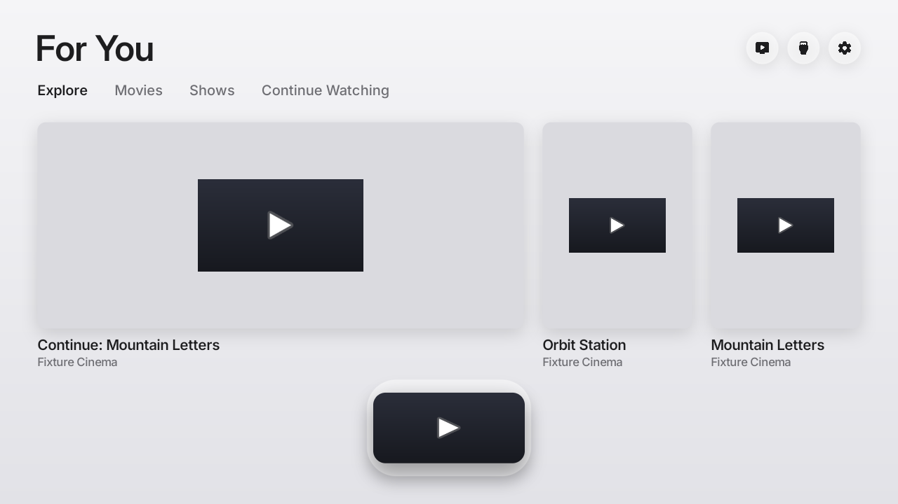

<div align="center">


# Free My TV

**A fast, ad-free home screen for Google TV and Android TV.**

Picks from your own apps, the weather at a glance, and a look that follows the sunset.<br>
Open source. Built with Claude Code. One button to undo.

[Install](#install) · [Any TV](#any-tv) · [Make it yours](#make-it-yours)



</div>

## What you get

- **No ads.** No sponsored rows, banners or autoplaying promos. Not one.
- **Your apps, front and center.** The streaming apps you actually use, on a glass shelf. Pick them and their order right on the TV.
- **Your choice of picks.** On Android TV, choose **From your apps**, **Discover (TMDB)** or **Off** in Home Settings. From your apps shows a scrolling row of recommendations published by your shelf apps, with three visible cards and a larger selected card. Both sources use the same expanding card row. Discover supplies three hourly picks from trending and recent movies and shows on installed streaming services.
- **Weather, one press away.** The hour-by-hour forecast, sunrise and sunset.
- **Light by day, dark by night.** It follows your city's real sunset, the way your phone does.
- **A screensaver to match.** Full-screen photos of the picks with a big glass clock.
- **Fast.** 60 fps, every frame in 16.6 ms, on the TV's own chip. The home screen uses 96 MB of memory instead of 242 MB (−60%).<br><sub>Measured on a 98″ TCL Google TV running Android 14.</sub>
- **Set up on the TV.** Language, your city, temperature, theme, the weather widget, and the apps on the shelf, in Free My TV's own settings.
- **Safe.** No root. Nothing is uninstalled. One button brings back the factory home screen.

## Install

About ten minutes. You need a Google TV or Android TV (Android 9 or newer) and a computer on the same Wi-Fi.

### The easy way: Claude Code

1. **On the TV**, turn on developer mode: Settings → System → About → press *Android TV OS build* 7 times. Then Settings → System → Developer options → turn on **USB debugging**. Write down the TV's IP address (Settings → Network & Internet).
2. **On your computer**, get the code:
   ```bash
   git clone https://github.com/yurasmetanka/free-my-tv && cd free-my-tv
   ```
3. **Open [Claude Code](https://claude.com/claude-code) in that folder** and say:
   > Install Free My TV on my TV at 192.168.1.50. I live in Lisbon.

   It installs the tools it needs, builds the app and puts it on your TV. Swap in your TV's IP and your city.
4. **On the TV**, open *Free My TV* → *Home Screen* → *Free My TV*, and accept the debugging prompt (tick *Always allow*).

### The manual way

1. **On the TV**, do step 1 above.
2. **Tools:** a JDK (17+), the Android SDK command-line tools (build-tools 34, platform android-34) and adb. On a Mac:
   ```bash
   brew install --cask temurin android-commandlinetools android-platform-tools
   sdkmanager "build-tools;34.0.0" "platforms;android-34"
   ```
   On Linux, get OpenJDK 17, Android's command-line tools and adb from your package manager, then run the same `sdkmanager` line. On Windows, use WSL.
3. **Build:**
   ```bash
   ./build.sh
   ```
   The first run creates `config.properties`. Set your city there, then run it again. Android TV recommendations do not need a TMDB key.
4. **Install:**
   ```bash
   adb connect 192.168.1.50:5555
   adb install -r FreeMyTV.apk
   ```
   On TCL TVs, also let it run in the background (TCL blocks it by default, and the switch never starts):
   ```bash
   adb shell "appops set io.freemytv AUTO_START allow || appops set io.freemytv APP_AUTO_START allow"
   ```
5. **On the TV**, open *Free My TV* → *Home Screen* → *Free My TV*.

## Settings

The first values come from `config.properties`, created by the first build. Most of them can also be changed on the TV, in *Free My TV* → *Home Settings*, and the TV's choice wins:

| Key | What it does | Default |
|---|---|---|
| `tmdb_key` | Your free TMDB key, for Discover (TMDB) | empty |
| `tmdb_region` | Your country (two letters): which titles are on which app | `US` |
| `latitude`, `longitude` | Your city, for the weather and the sunset | New York |
| `city` | The name on the weather card | `Weather` |
| `language` | `auto` (follows the TV), `en`, `es`, `pt`, `ru` or `de` | `auto` |
| `temperature` | `C`, `F` or `auto` | `auto` |
| `disable_assistant` | Also turn off Google Assistant | `false` |

Changed something? Run `./build.sh` and install again. Keep `freemytv.keystore`: updates are signed with it.

### The TMDB key

Android TV defaults to **From your apps**, with no TMDB key needed. Allow TV-listing access when prompted. Only shelf apps that publish Android TV preview or Watch Next entries can contribute; apps without entries show no picks. Cards open the publishing app's content link, and use its logo if artwork is unavailable. Explore, Movies, Shows and Continue Watching have their own tabs. Movie and show categories follow the publishing app’s media type; music and general video clips stay in Explore. Choose **Off** for the clock instead.

To use **Discover (TMDB)**, add a key below, rebuild, then select it in Home Settings. It keeps the existing Explore, Movies and Shows tabs and three picks per hour, matched to installed streaming services in your country. Existing Android installations also start with From your apps until you select another source; their TMDB configuration is kept.

Free, and it takes two minutes: create an account at [themoviedb.org](https://www.themoviedb.org/signup), then open [Settings → API](https://www.themoviedb.org/settings/api) and request a developer key. Paste the *API Read Access Token* (or the *API Key*) after `tmdb_key=`. It's your key: `config.properties` stays out of git.

## Going back

On the TV: *Free My TV* → *Home Screen* → *Original*. The factory home screen, screensaver and every app come back exactly as they were. If the new home screen ever crashes three times in five minutes, it switches back by itself.

To remove it for good, switch to *Original* first, then uninstall *Free My TV* (Settings → Apps).

## What it changes

- It becomes the home screen and the screensaver.
- It turns off, without uninstalling:
  - the stock home screen and screensaver;
  - Google TV's recovery home, Play Games and YouTube Music;
  - on TCL TVs, the TCL Channel, messages, store demo, hotel menu, manuals, mirroring and logging apps;
  - on Philco TVs, AI PONT (promo channels and app downloads) and the manual;
  - on Multilaser TVs, Anoki's screen-content recognition (ACR), the store demo and the manual;
  - Google Assistant, only with `disable_assistant=true`.
- On TCL TVs, the remote's Netflix, YouTube and Prime buttons keep working through a small accessibility service that only reads those buttons. Pick what each one opens in *Free My TV* → *Remote Buttons*; *Original* turns the service off. On Vestel-made TVs (F&U and other store brands) the same goes for the Netflix button.
- Picture, sound, inputs, remote pairing, Google services and the Play Store are on a protected list, checked before every change.
- Apps that saved a Wi-Fi network are never turned off, since Android would erase the network. If the TV's first setup saved yours, the switch asks you to forget the network and connect again in Settings first (saved networks out of range don't show there; Claude Code can remove them).

## Any TV

Free My TV runs on Google TV and Android TV: TCL, Sony, Hisense, Philips, Xiaomi, Vestel-made TVs (F&U) and more, plus streamers like Chromecast with Google TV, the Google TV Streamer, onn 4K and NVIDIA Shield.

**Any other TV:** plug a Google TV streamer into HDMI and free that one. Same steps, same home screen.

**A different brand or model:** ask Claude. Free My TV is made to be adapted by AI. Open the folder in Claude Code and say *"set it up for my Sony"*: it reads your TV, finds its home screen and its promo apps, updates the lists below and walks you through a test. [CLAUDE.md](CLAUDE.md) tells it how.

| What | Where |
|---|---|
| Apps to turn off | `DEBLOAT` in [`HomeMode.java`](app/src/io/freemytv/HomeMode.java) |
| Apps never to touch | `PROTECTED` in the same file |
| Apps on the shelf | `SHELF` in [`HomeApps.java`](app/src/io/freemytv/HomeApps.java) |
| Your brand's live TV app | `LIVE_TV_APPS` in the same file |

## Make it yours

It's your code, and Claude Code finds its way around it. Try:

- *"Add Crunchyroll to the shelf."*
- *"Add Spanish."*
- *"Switch to the night look an hour after sunset."*

## How it works

- **A plain Android app, no Gradle, no libraries.** [`build.sh`](build.sh) runs aapt2 → javac → d8 → zipalign → apksigner and makes a 2 MB APK.
- **It uses the TV's own ADB, from inside the TV.** The app connects to `127.0.0.1:5555` with its own key (that's the *Allow USB debugging?* prompt) and runs the same commands you would: `cmd package set-home-activity`, `settings put secure screensaver_components`, `pm disable-user`. Nothing listens to the network.
- **Drawn by hand on one Canvas**, with Android 13 shaders for the frosted glass and the sky (plain fills on Android 9 to 12, with lighter shadows and no GPU layers on 9 to 11 for their older GPUs).
- **A safety net.** A watchdog in a separate process brings back the stock home screen after three crashes in five minutes, and a boot check keeps your choice after TV updates.
- **Data** from TMDB (trending titles, new releases and which app streams what in your country), Open-Meteo (forecast, sunrise and sunset).

| File | What it is |
|---|---|
| [`HomeView.java`](app/src/io/freemytv/HomeView.java) | The home screen |
| [`HomeMode.java`](app/src/io/freemytv/HomeMode.java) | Switching between Free My TV and Original |
| [`Adb.java`](app/src/io/freemytv/Adb.java) | The TV's own ADB, from inside the TV |
| [`Recs.java`](app/src/io/freemytv/Recs.java) | Recommendation source selection and shared cards |
| [`NativeRecs.java`](app/src/io/freemytv/NativeRecs.java) | Shelf apps’ Android TV Preview and Watch Next feeds |
| [`TmdbRecs.java`](app/src/io/freemytv/TmdbRecs.java) | Optional Discover (TMDB) feed |
| [`HomeData.java`](app/src/io/freemytv/HomeData.java) | Weather forecast |
| [`HomeApps.java`](app/src/io/freemytv/HomeApps.java) | The shelf, inputs and All Apps |
| [`DreamView.java`](app/src/io/freemytv/DreamView.java) | The screensaver |
| [`SettingsActivity.java`](app/src/io/freemytv/SettingsActivity.java) | The settings screen (the app's icon) |
| [`Prefs.java`](app/src/io/freemytv/Prefs.java) | Settings changed on the TV |
| [`RemoteKeys.java`](app/src/io/freemytv/RemoteKeys.java) | The TCL remote's app buttons |
| [`Watchdog.java`](app/src/io/freemytv/Watchdog.java) | The safety net |


## Development

For a repeatable emulator cycle with a mock streaming app, real TV-provider recommendations, artwork, and offline weather, see [dev/README.md](dev/README.md).

Requires JDK 17+, Android SDK Build-Tools 34.0.0 and platform android-34. Set `ANDROID_HOME` to your SDK and `JAVA_HOME` to your JDK, then run:

```sh
./build.sh
bash tests/build.sh
"$ANDROID_HOME/build-tools/34.0.0/apksigner" verify FreeMyTV.apk
```

The app and instrumentation APK build without Gradle or third-party libraries. Run the recommendation checks on a connected Android TV device as described in [tests/README.md](tests/README.md). Building the checks does not execute them.

- `app/`: Android manifest, Java sources, resources and bundled assets.
- `tests/`: recommendation instrumentation checks and their build script.
- `dev/`: emulator lifecycle, fixture publisher and offline integration workflow.
- `tools/`: optional Android artwork and symbol generators (require Pillow).
- `out/`: ignored generated code, classes and intermediate APKs.

Keep `config.properties` and `freemytv.keystore` local. The build recreates `out/`; updates require the same signing key.

## Privacy

No accounts, no analytics, no tracking. The app talks to TMDB and Open-Meteo (with the coordinates you set). Your settings stay on your computer and your TV.

## Credits

- Built with [Claude Code](https://claude.com/claude-code).
- This product uses the TMDB API but is not endorsed or certified by [TMDB](https://www.themoviedb.org/).
- Weather data by [Open-Meteo.com](https://open-meteo.com/) (CC BY 4.0).
- Icons: [Material Symbols](https://fonts.google.com/icons) (Apache 2.0). Font: [Inter](https://rsms.me/inter/) (SIL OFL 1.1).
- Not affiliated with Google, TCL or any streaming service. App names and logos belong to their owners.

## License

[MIT](LICENSE). Fork it, change it, ship it.
